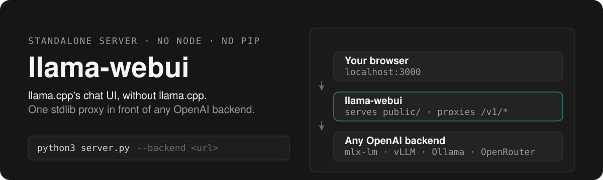
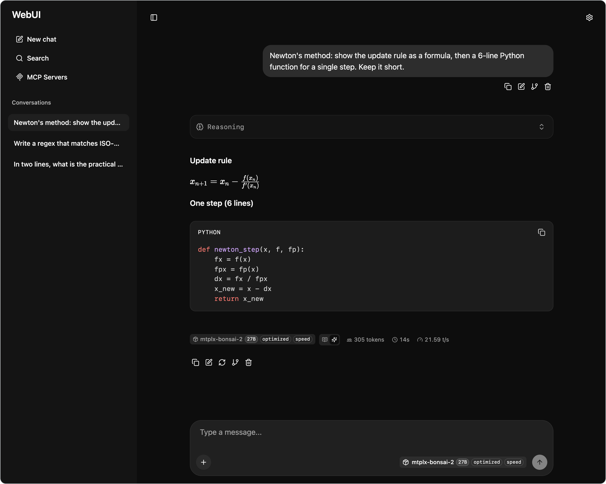
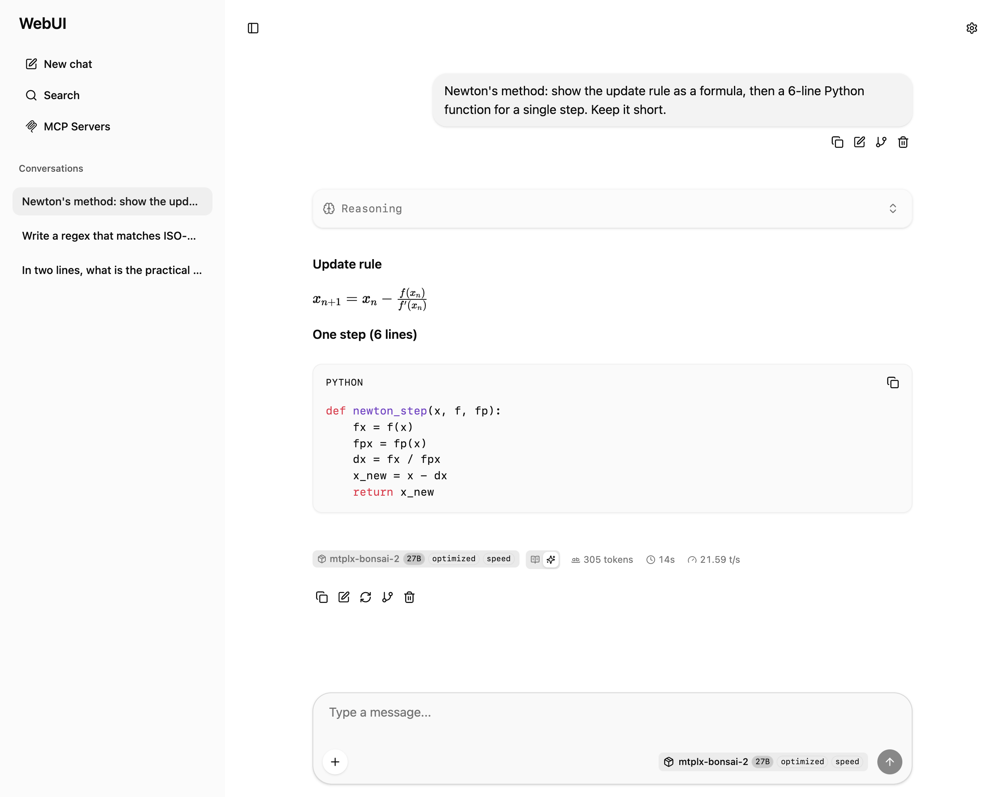

<p align="center">
  
</p>

**llama.cpp's Web UI, without llama.cpp.** One 643-line stdlib Python server serves the prebuilt [Svelte 5 chat interface](https://github.com/ggml-org/llama.cpp/tree/master/tools/server/webui) and proxies `/v1/*` to any OpenAI-compatible backend — mlx-lm, llama.cpp, vLLM, Ollama, OpenRouter, or your own.



*`server.py` in front of a local OpenAI-compatible backend: KaTeX, highlighted code, a collapsible reasoning panel and live tokens/sec. No llama.cpp process behind it.*

## Run it

```bash
git clone https://github.com/shivam2014/llama-webui.git
cd llama-webui

# a local backend
python3 server.py --backend http://localhost:8080

# or a hosted provider — the key stays on the server
python3 server.py --backend https://openrouter.ai/api/v1 --backend-api-key sk-or-v1-...

# then open http://localhost:3000
```

No build step, no Node.js, no `pip install`. Python 3.10+ standard library only.

## What you get

The real llama.cpp interface, with that project's C++ server replaced by a proxy:

- Streaming chat with live tokens/sec, token counts and context usage
- Reasoning and thinking panels from Qwen, DeepSeek and other reasoning models
- Markdown, syntax highlighting and KaTeX math
- Conversation branching, editing, regeneration, deletion
- Import and export of conversations as JSON
- File attachments: images, PDF, audio, plain text
- Dark and light themes, following the system preference
- A model selector populated from the backend's `/v1/models`
- Keyboard shortcuts



*Same conversation, light theme. The theme follows the system preference until you pin one in settings.*

## Why this exists

MLX is excellent on Apple Silicon but had no polished chat UI. llama.cpp's Web UI is clean and feature-rich, yet it ships tightly coupled to llama.cpp's own server. This separates the two, so an mlx-lm, vLLM or Ollama backend gets the same interface llama.cpp users get.

## How it works

- **Static files** — the prebuilt Svelte 5 UI (`index.html`, `bundle.js`, `bundle.css`) is served from `public/`.
- **API proxy** — every `/v1/*` request is forwarded to `--backend`.
- **SSE injection** — the proxy adds `timings` (tokens/sec stats) and renames `delta.reasoning` to `delta.reasoning_content`, so backends using OpenAI's field naming work unchanged.
- **Line-by-line streaming** — each SSE event is forwarded as it arrives, with no batching.
- **Model discovery** — `/props` reports the model discovered from the backend's `/v1/models`.
- **Stubs** — `/slots` returns a minimal response for interface compatibility.

## Usage

```
python server.py [OPTIONS]
```

| Option | Default | Env var | Description |
|---|---|---|---|
| `--host` | `127.0.0.1` | `LLAMA_WEBUI_HOST` | Bind address |
| `--port` | `3000` | `LLAMA_WEBUI_PORT` | Listen port |
| `--backend` | `http://localhost:8080` | `LLAMA_WEBUI_BACKEND` | Backend API URL |
| `--backend-api-key` | none | `LLAMA_WEBUI_BACKEND_API_KEY` | API key for the backend, kept server-side |
| `--backend-api-key-header` | `Authorization` | `LLAMA_WEBUI_BACKEND_API_KEY_HEADER` | Header carrying that key; `Authorization` is sent as `Bearer <key>` |
| `--vision` | off | `LLAMA_WEBUI_VISION=1` | Enable vision (image upload) |
| `--audio` | off | `LLAMA_WEBUI_AUDIO=1` | Enable audio (voice input) |
| `--ctx-size` | `8192` | `LLAMA_WEBUI_CTX_SIZE` | Default context window |
| `--verbose` / `-v` | off | `LLAMA_WEBUI_VERBOSE=1` | Debug logging |

```bash
# With mlx-lm
python server.py --backend http://localhost:8080

# With vLLM on another port
python server.py --backend http://localhost:8000 --port 4000

# With vision support (LLaVA and friends)
python server.py --backend http://localhost:8080 --vision

# With a backend that wants a non-Bearer header
python server.py --backend http://localhost:8080 \
    --backend-api-key-header api-key --backend-api-key secret

# Public-facing (put an auth proxy in front)
python server.py --host 0.0.0.0 --port 3000
```

## Notes

- Client headers, including `Origin`, are forwarded to the backend. If a backend refuses cross-origin requests, chat requests fail with `403`.
- `--backend-api-key` replaces any `Authorization` header the browser sends, and is never logged or exposed by `/props`. Without the flag, the key typed into the UI's API Key setting is forwarded instead.
- The UI is served as static files, so edits to `public/` appear on reload.
- Need several providers at once? Run a gateway such as [LiteLLM](https://docs.litellm.ai/docs/simple_proxy) and point `--backend` at it — this server only needs one OpenAI-compatible URL.

## Updating the UI bundle

```bash
# Build from source (requires Node.js + npm)
cd /path/to/llama.cpp/tools/server/webui
npm install
npm run build

# Or copy the prebuilt output from a llama.cpp checkout
cp /path/to/llama.cpp/tools/server/public/* ~/llama-webui/public/
```

## Credits

The UI is the [llama.cpp Web UI](https://github.com/ggml-org/llama.cpp/tree/master/tools/server/webui), a Svelte 5 + TailwindCSS 4 application built by the llama.cpp community. All credit for the frontend design, components and functionality belongs to them.

This repository contributes the standalone Python wrapper around it:

- serving the prebuilt UI as static files
- proxying API requests to any OpenAI-compatible backend
- injecting timing data for tokens/sec statistics
- bridging field-naming differences between backends

## License

The UI bundle is from [llama.cpp](https://github.com/ggml-org/llama.cpp) (MIT). The server wrapper (`server.py`) is MIT.
