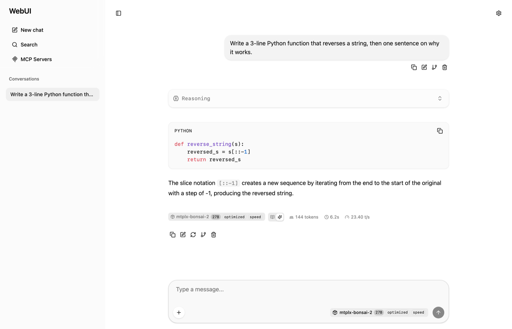

<p align="center">
  
</p>

**llama.cpp's Web UI, without llama.cpp.** A 643-line Python server serves the prebuilt [Svelte 5 chat interface](https://github.com/ggml-org/llama.cpp/tree/master/tools/server/webui) and proxies `/v1/*` to any OpenAI-compatible backend — mlx-lm, llama.cpp, vLLM, Ollama, or your own.

No build step. No Node.js. No pip install. Python 3.10+ standard library only.

## Why this exists

MLX has excellent model support on Apple Silicon, but it was missing a polished chat UI. llama.cpp's Web UI is clean and feature-rich — streaming, reasoning display, conversation branching, markdown and KaTeX rendering, file attachments — but it ships tightly coupled to llama.cpp's C++ server.

This project separates the two. Point it at mlx-lm and you get the same experience you would get from llama.cpp's own server.

## Quick start

```bash
# 1. Clone
git clone https://github.com/shivam2014/llama-webui.git
cd llama-webui

# 2. Start your backend (mlx-lm, llama.cpp, etc.) on port 8080

# 3. Run the UI server — no pip install needed
python3 server.py --backend http://localhost:8080

# 4. Open http://localhost:3000
```

## Usage

```
python server.py [OPTIONS]
```

| Option | Default | Env var | Description |
|---|---|---|---|
| `--host` | `127.0.0.1` | `LLAMA_WEBUI_HOST` | Bind address |
| `--port` | `3000` | `LLAMA_WEBUI_PORT` | Listen port |
| `--backend` | `http://localhost:8080` | `LLAMA_WEBUI_BACKEND` | Backend API URL |
| `--vision` | off | `LLAMA_WEBUI_VISION=1` | Enable vision (image upload) |
| `--audio` | off | `LLAMA_WEBUI_AUDIO=1` | Enable audio (voice input) |
| `--ctx-size` | `8192` | `LLAMA_WEBUI_CTX_SIZE` | Default context window |
| `--verbose` / `-v` | off | `LLAMA_WEBUI_VERBOSE=1` | Debug logging |

```bash
# With mlx-lm
python server.py --backend http://localhost:8080

# With vLLM
python server.py --backend http://localhost:8000 --port 4000

# With vision support (LLaVA and friends)
python server.py --backend http://localhost:8080 --vision

# Public-facing (put an auth proxy in front)
python server.py --host 0.0.0.0 --port 3000
```

## How it works

```
Browser ──> llama-webui (port 3000) ──proxy /v1/*──> Backend (port 8080)
              │
              ├── serves static UI files from public/
              └── stubs /props and /slots endpoints
```

- **Static files** — the prebuilt Svelte 5 UI (`index.html`, `bundle.js`, `bundle.css`).
- **API proxy** — every `/v1/*` request is forwarded to the backend.
- **SSE injection** — the proxy injects `timings` (tokens/sec stats) and renames `delta.reasoning` to `delta.reasoning_content`, so backends using OpenAI's field naming work unchanged.
- **Line-by-line streaming** — each SSE event is forwarded immediately, with no batching.
- **Model discovery** — `/props` discovers the active model from the backend's `/v1/models`.
- **Stubs** — `/slots` returns a minimal response for interface compatibility.



*A real conversation through the proxy — `mtplx-bonsai-2 27B` answering with syntax highlighting, a collapsible reasoning block, and live throughput (144 tokens at 23.4 tok/s). No llama.cpp process behind it.*

## Features

- Streaming chat with real-time tokens/sec stats
- Reasoning and thinking content display (Qwen, DeepSeek, and others)
- Conversation branching, editing, regeneration, deletion
- Import and export conversations as JSON
- Markdown with syntax highlighting (highlight.js)
- KaTeX math rendering
- Dark and light themes, following the system preference
- File attachments: images, PDF, audio, text
- Model selector populated from the backend's `/v1/models`
- Keyboard shortcuts

## Requirements

- Python 3.10+
- An OpenAI-compatible LLM server (mlx-lm, llama.cpp, vLLM, Ollama, ...)

## Files

```
llama-webui/
├── server.py         # Python HTTP server + reverse proxy (643 lines)
├── public/
│   ├── index.html    # UI entry point
│   ├── bundle.js     # Svelte 5 app bundle (6.2MB)
│   ├── bundle.css    # TailwindCSS styles (489KB)
│   └── loading.html  # Loading placeholder
└── README.md
```

## Updating the UI bundle

```bash
# Build from source (requires Node.js + npm)
cd /path/to/llama.cpp/tools/server/webui
npm install
npm run build

# Or copy the prebuilt output from a llama.cpp checkout
cp /path/to/llama.cpp/tools/server/public/* ~/llama-webui/public/
```

## Credits

The UI is the [llama.cpp Web UI](https://github.com/ggml-org/llama.cpp/tree/master/tools/server/webui), a Svelte 5 + TailwindCSS 4 application built by the llama.cpp community. All credit for the frontend design, components and functionality belongs to them.

This repository contributes the standalone Python wrapper around it:

- serving the prebuilt UI as static files
- proxying API requests to any OpenAI-compatible backend
- injecting timing data for tokens/sec statistics
- bridging field-naming differences between backends

## License

The UI bundle is from [llama.cpp](https://github.com/ggml-org/llama.cpp) (MIT). The server wrapper (`server.py`) is MIT.
